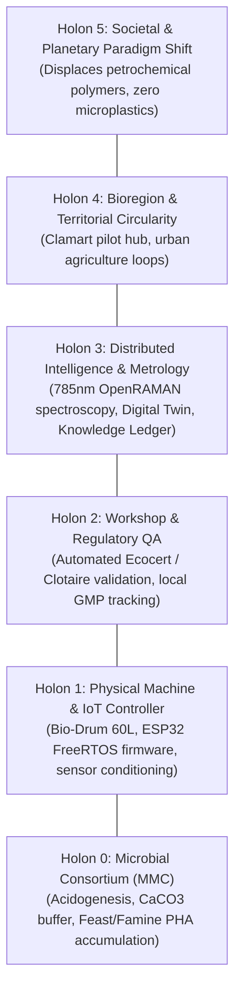

# 🌿 Sentinel-Holarchy: Universal Bio-Foundry & Decentralized Biorefinery

[](https://github.com/mdecatelan/sentinel-holarchy/actions)
[](https://www.python.org/)
[](https://opensource.org/licenses/MIT)
[](docs/CLAMART_PROTOTYPE_GUIDE.md)
[](docs/ECOCERT_UAB_COMPLIANCE.md)

> **Sentinel-Holarchy** is an open cyber-physical platform replacing hyper-centralized petrochemical infrastructure with an autonomous, low-CapEx network of decentralized micro-biorefineries.
> Built on **Arthur Koestler’s Holarchy Theory**, the platform converts raw urban biowaste (kitchen scraps, starch, eggshells) into high-value **marine-biodegradable PHA bioplastics**, **organic-certified biostimulants**, and **calcium-buffered soil amendments**.

---

## 🏛️ The 6-Level Holarchic Architecture

In a holarchy, every unit (**holon**) is simultaneously a self-regulating, autonomous whole at its scale, and an integrated component of the supra-system.



---

## ⚡ The 3 Valorised Product Streams

Each 72-hour cycle converts unprocessed kitchen organics into 3 cleanly fractionated outputs:

```
[ Household Biowaste ] ───>  BIO-DRUM 60L (72h Cycle)
                                      │
        ┌─────────────────────────────┼─────────────────────────────┐
        ▼                             ▼                             ▼
   [ GRADE A ]                   [ GRADE B ]                   [ GRADE C ]
Bacterial Biomass            Clarified Broth               Solid Marc
        │                             │                             │
        ▼                             ▼                             ▼
Polyhydroxyalkanoates        Organic Biostimulant          Calcium-Buffered
    (PHA Polymer)              (Ecocert / UAB)                 Amendment
 - 100% Ocean degradable      - Reg (EU) 2018/848           - Humic complex
 - 3D Printing filament       - Rich in organic acids       - Replaces chemical
 - Micro-encapsulation        - Zero synthetic inputs         NPK fertilizers
```

---

## 📂 Repository Structure

```
├── .github/workflows/ci.yml        # Automated GitHub Actions test pipeline
├── docs/
│   ├── HOLARCHY_ARCHITECTURE.md    # Complete theoretical foundations
│   ├── CLAMART_PROTOTYPE_GUIDE.md  # Physical build manual & BOM (< 300 €)
│   ├── ECOCERT_UAB_COMPLIANCE.md   # Regulatory dossier for UAB certification
│   └── ALIGNERR_PROJECT_OVERVIEW.md# Technical project brief for Alignerr
├── src/sentinel_holarchy/
│   ├── holon0_microbial/           # Biomass formulation & Monod/Haldane kinetics
│   ├── holon1_hardware/            # Bio-Drum FSM controller & ESP32 firmware (.ino)
│   ├── holon2_workshop/            # Automated Ecocert auditor & batch records
│   ├── holon3_intelligence/        # OpenRAMAN 785nm pipeline & Knowledge Ledger
│   ├── holon4_territory/           # Clamart bioregional mass balance model
│   └── holon5_paradigm/            # LCA & avoided carbon displacement metrics
├── dashboard/                      # Web-based supervisory interface (HTML/JS)
├── scripts/
│   ├── run_batch_demo.py           # 3-lot operational demonstration
│   └── run_server.py               # REST API gateway & telemetry server
├── tests/                          # 17 automated pytest verification tests
├── pyproject.toml                  # Modern Python package configuration
└── requirements.txt                # Core dependencies
```

---

## 🚀 Quickstart

### 1. Installation
Clone the repository and install dependencies:
```bash
git clone https://github.com/mdecatelan/sentinel-holarchy.git
cd sentinel-holarchy
pip install -r requirements.txt
pip install -e .
```

### 2. Run Automated Verification Tests
```bash
python -m pytest -v
```
Output:
```
tests/test_holon0_kinetics.py::test_formulator_clamart_batch PASSED
tests/test_holon0_kinetics.py::test_acidogenesis_vfa_production PASSED
tests/test_holon0_kinetics.py::test_pha_accumulation_feast_famine PASSED
tests/test_holon0_kinetics.py::test_full_72h_protocol_runner PASSED
tests/test_holon1_hardware.py::test_state_machine_nominal_flow PASSED
tests/test_holon1_hardware.py::test_state_machine_thermal_safety_trip PASSED
tests/test_holon1_hardware.py::test_telemetry_packet_validation PASSED
tests/test_holon2_ecocert.py::test_ecocert_audit_pass PASSED
tests/test_holon2_ecocert.py::test_ecocert_audit_fail_heavy_metal PASSED
tests/test_holon2_ecocert.py::test_ecocert_audit_fail_salmonella PASSED
tests/test_holon2_ecocert.py::test_production_batch_record PASSED
tests/test_holon3_openraman.py::test_raman_synthetic_spectrum_and_baseline_subtraction PASSED
tests/test_holon3_openraman.py::test_raman_purity_estimation_and_coa PASSED
tests/test_simulation_ledger.py::test_knowledge_ledger_experience_gain PASSED
tests/test_simulation_ledger.py::test_digital_twin_simulation_step PASSED
tests/test_simulation_ledger.py::test_clamart_territory_mass_balance PASSED
tests/test_simulation_ledger.py::test_societal_impact_lca PASSED
============================== 17 passed in 1.15s ==============================
```

### 3. Run the Multi-Lot Knowledge Accumulation Demo
```bash
python scripts/run_batch_demo.py
```

### 4. Launch the Local Telemetry Gateway & Dashboard
```bash
python scripts/run_server.py
```
Open your browser at `http://127.0.0.1:5000/` to visualize real-time reactor telemetry, kinetics, and spectral audits.

---

## 🔬 Scientific & Engineering Highlights

### 1. In-situ CaCO3 Buffering Dynamics
Slurry acidification during acidogenesis is passively moderated by calcium carbonate from crushed eggshells:
$$\text{CaCO}_3 + 2\text{H}^+ \rightleftharpoons \text{Ca}^{2+} + \text{H}_2\text{O} + \text{CO}_2$$
This stabilizes pH in the optimal acidogenic range ($5.5 \le \text{pH} \le 6.0$) without synthetic alkaline chemicals.

### 2. Feast/Famine PHA Biosynthesis
Under strict nitrogen deprivation and intense micro-bubble aeration, bacteria divert volatile fatty acids into intracellular polyhydroxyalkanoate granules:
$$q_{\text{PHA}} = q_{\text{PHA}}^{\max} \cdot \left(\frac{\text{VFA}}{K_{\text{VFA}} + \text{VFA}}\right) \cdot \left(1 - \frac{f_{\text{PHA}}}{f_{\text{PHA}}^{\max}}\right)$$

### 3. OpenRAMAN 785nm Spectral Verification
Non-destructive vibrational spectroscopy replaces liquid chromatography (HPLC). The software automatically subtracts fluorescence background and integrates the $C=O$ ester carbonyl stretch at **$1732\text{ cm}^{-1}$** relative to the $C-H$ bending reference at **$1453\text{ cm}^{-1}$**, generating a tamper-proof SHA-256 Certificate of Analysis (CoA).

---

## 📜 Regulatory Certification
The Grade B liquid fraction meets all criteria for **Utilisable en Agriculture Biologique (UAB)** under **EU Regulations 2018/848 and 2021/1165**, with automated audit checks ready for the **Ecocert Clotaire** database.

---

## 📄 License
This project is licensed under the [MIT License](LICENSE).
Open hardware designs are compliant with CERN-OHL principles.
